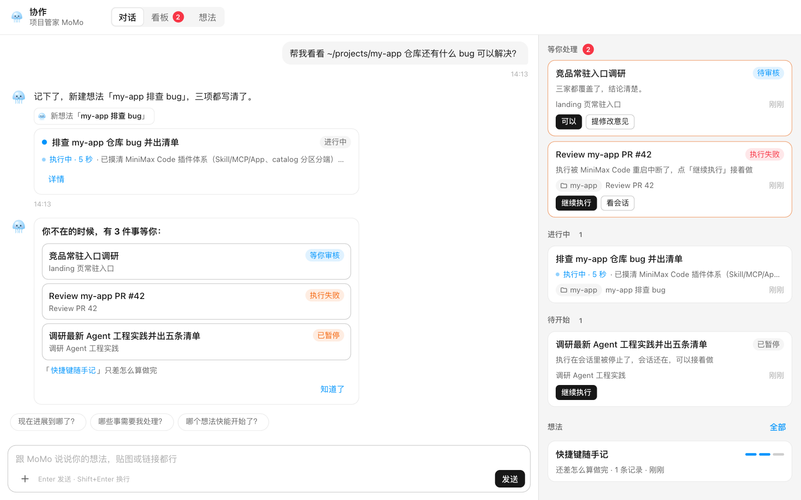
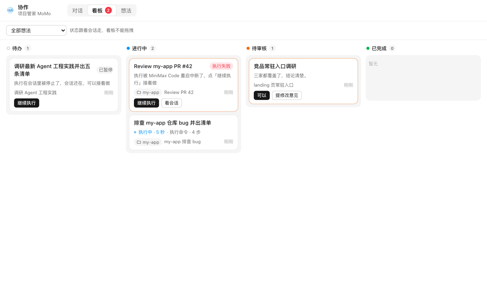

# 协作 · MoMo

[English](README.md) | 简体中文

MoMo 是 MiniMax Code 里的项目管家。随手冒出的想法、一张截图、一个链接，丢给 MoMo 就行：它把内容记成一条记录，归到对应的想法里；陪你把想法聊清楚，写成任务；你同意后安排 Agent 会话去执行，交接背景、跟进进度、按你定的验收标准核对结果，再把结论收回想法。看板上一眼可见每个任务处在待办、进行中、待审核还是已完成。

作者：[amszuidas](https://github.com/amszuidas) · 版本：`0.2.0`

*预览图使用合成数据。*

## 安装与打开

把整个目录（包括隐藏的 `.minimax-plugin` 目录）复制到 `<dataDir>/plugins/momo-collab/`，`<dataDir>` 默认是 `~/.minimax`。重启 MiniMax Code，确认插件已识别并启用。

在**项目会话**（有项目目录的会话）里打开：在输入框输入 `@协作 · MoMo` 发送，或从会话侧边面板的 Mini App 入口打开。页面可以弹出为独立窗口。任务默认在打开页面的那个会话所在项目里执行，MoMo 也可以给任务另设项目目录。

## 能做什么

- **和 MoMo 的一段对话**：一句话、截图或链接，MoMo 记成记录，归到已有想法、新建想法或先记为未归属，并在回复下挂回执；说「不对，记到 X」可以改记。
- **想法**：每个想法跟踪三项——做什么、产出什么、怎么算做完，并标出「已确认」还是「推断」；同时保留记录、已确定的事、任务和产出。想深挖时，MoMo 会一问一答帮你把想法问清楚。
- **任务**：三项写清后，MoMo 写出任务卡片。点「开始」执行，或点「先不做」先放着。开始后新开一个 Agent 会话，并带上完整交接：目标、产出、验收标准、已确认的事实和记录。任务状态跟着会话走，看板不能拖拽，也没有手动改状态的按钮。
- **实时进度**：执行中的卡片显示已用时间、当前工具和步数；点卡片在聊天侧边面板打开任务会话，可以看过程或直接接手。
- **受阻**：卡片说明受阻原因（待批准、待补充信息、执行失败、项目不可用），并给出唯一的下一步：批准或拒绝、回答、重试、设置项目目录。
- **审核**：执行会话提交后，MoMo 在独立会话里按每条验收标准核对产出，再交给你审核；可以直接通过，也可以提修改意见，回到原会话继续改。
- **把会话交给 MoMo**：在任意普通会话里说「把这个会话交给 MoMo」，内置 Skill 会把这个会话的结论记到对应想法下（需要协作 Mini App 正在运行）。
- **回来时**：离开一段时间再回来，MoMo 会列出需要你处理的事；「试用指标」页汇总本地使用数据。

## 测试环境

- macOS 26.6 上的 MiniMax Code 3.1.3（内部预览版）。本插件声明了 `agentAccess`、`agentConcurrency` 和 `surface.window`，需要 MiniMax Code 3.1.2 或更高版本。
- 未在 Windows 上测试。
- 另外用真实的 Node 入口、MCP 端点和模拟 Agent 端到端跑过任务全流程（创建、开始、宿主停止、继续、批准、提交、核对、审核、完成），并在浏览器中检查了 1180 px 和 420 px 两种宽度下的页面。

## 数据与权限

- **Agent 轮次**：声明 `agentAccess: ["session.run"]`，`agentConcurrency: 8`。会运行三类 Agent 轮次，每类都具备 Agent 的完整能力（文件、shell、Skill、MCP）：
  - **MoMo**：一个长期会话，通过本插件的 `momo` MCP 工具记录、维护想法和写任务。
  - **任务会话**：每个任务一个。由页面调用 `agent.create()` 创建，因此使用该会话的 agent、模型和项目目录。首条消息交接任务，并要求 Agent 通过 `momo` 工具汇报进度、提交产出。
  - **核对**：每次核对一个独立会话，读取提交的产出，按每条验收标准记录满足或不满足。
- **批准**：每个 `permission.requested` 都显示在任务卡片或对话里，只有你点击后才发送 `allowOnce`，从不自动批准。任务执行失败会在同一会话里自动重试一次，提示 Agent 从中断处继续；触发条件是轮次以 `status: "error"` 结束，或者调用在任何工具开始前就以可重试错误被拒绝。`AGENT_OUTCOME_UNKNOWN` 从不重试。
- **插件写入的文件**：
  - `context.dataDir/state.json`：想法、记录、任务和对话，通过临时文件加重命名原子写入。
  - `context.dataDir/telemetry.jsonl`：「试用指标」页用的本地使用事件，不上传。
  - 与 Host 各 agent 数据并列的一个 Agent 可读目录：`<dataDir>/agents/mavis/miniapps/momo-collab/`。其中 `uploads/` 存放你附加的图片，`outputs/<taskId>/` 存放不绑定项目的任务产出。插件从 `context.dataDir` 向上四级定位这个目录，依赖的是 Host 数据目录当前未公开约定的布局；该目录不存在时改用 `context.dataDir`。用它是因为主 agent 读取这里无需批准，任务才能直接读到你的截图。
- **读取 `dataDir` 以外的文件**：页面只预览任务会话上报过路径的产出（最大 5 MiB），核对会话同样只读这些文本产出。MiniMax Code 数据目录内的文件一律拒绝，上面的产出目录除外。项目目录必须是已存在的绝对路径，且不能在 MiniMax Code 数据目录内。
- **Agent 写入的文件**：任务会话在项目目录里工作，可能按任务需要创建或修改其中的文件；这正是任务的目的，并受你的批准约束。
- **进程**：插件本身不启动任何进程。
- **网络**：Node 服务不发起任何外部请求，页面不加载远程资源。
- **浏览器存储**：`sessionStorage` 保存一个随机页面 ID，让刷新后的页面继续收到属于自己的开工请求。
- **MCP**：`servers.mcp.json` 声明 `momo` MCP 服务，由本 Mini App 在 `/mcp/momo` 提供；工具只读写想法、记录和任务，不读写文件。

## 已知限制

- 任务会话通过 Mini App Agent API 创建，不出现在会话列表里，需要从任务卡片打开。
- 任务没有设置项目目录时，在打开页面的那个会话所在项目里执行；不在项目会话里打开时，回退到插件自己的 Agent 目录。
- 没有侧栏入口、全局快捷键和系统通知，需要从会话里打开 Mini App。
- 重启 MiniMax Code 会中断执行中的任务，任务显示「执行失败」，点「继续执行」在原会话续跑。
- `momo` MCP 工具只在 Mini App 运行时可用。

## 源码

页面在 `miniapp/client/`，Node 服务在 `miniapp/node/`：`server.mjs` 负责 HTTP、SSE 和上传，`engine.mjs` 负责开工调度、核对和 Agent 事件，`store.mjs` 管理状态，`mcp.mjs` 提供 MCP 端点，`prompts.mjs` 放角色、交接和核对的提示词。无需构建，没有依赖。

## 许可证

[MIT](LICENSE)。
