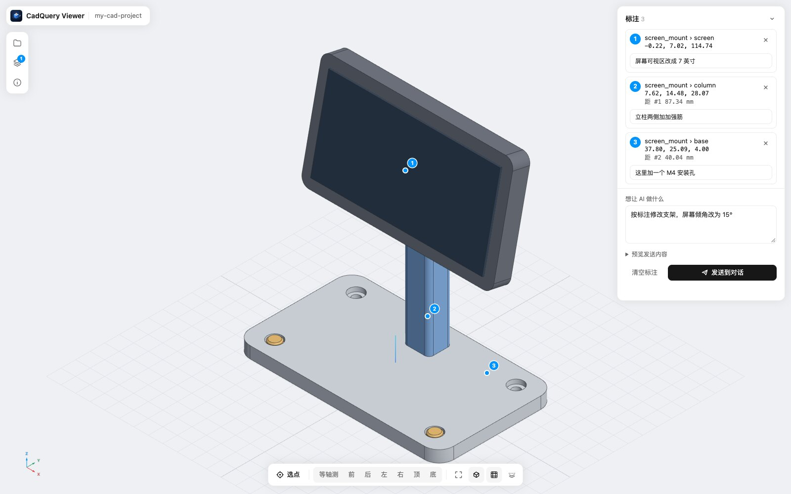

# CadQuery Viewer

简体中文 | [English](README.md)

<picture>
  <source media="(prefers-color-scheme: dark)" srcset="docs/brand/cqviewer-lockup-dark.png">
  
</picture>

MiniMax Code 里的本地 3D 模型查看器。打开项目文件夹里的 STL 和 STEP（STEP 装配保留零件名称、颜色和真实 CAD 边线），实时显示 CadQuery 脚本推送的模型，在模型上标出位置后一键发到对话里，让 AI 准确知道你说的是哪个面、哪个孔、哪条边。

作者：[HanZijie](https://github.com/HanZijie) · 版本：`1.0.0`



## 功能

| 模块 | 说明 |
| --- | --- |
| 查看 | 全窗口画布，正交相机，Z 轴向上（与 CadQuery 一致）。7 个预设视角、适配、边线、网格、X/Y/Z 剖切、坐标轴指示，跟随亮色/暗色主题。 |
| 项目文件夹 | 递归列出文件夹里的 `.stl`、`.step`、`.stp`，勾选即打开；文件在磁盘上变化时自动重新加载。 |
| STEP | 在本机转换成网格，保留装配结构：零件名称、位置、颜色和 B-rep 边线（隐藏缝合线）。「已打开」里显示文件包含几个零件。转换结果会缓存。 |
| CadQuery 推送 | `python/cqview.py` 的 `show(零件或装配, "名字")` 写入 `~/.cqview/scene/`，Viewer 立即显示。装配以 STEP 推送，名称和颜色都保留。 |
| 标注 | 选点模式（`P`）：在表面上连续点多个位置，再确认（`Enter`）。每个点记录所在零件、装配里的子零件、坐标和表面法向；每个点可写备注，再写一句想让 AI 做什么。 |
| 发给 AI | 一个按钮把整理好的消息发到对话（见[发送到对话](#发送到对话)）。同样的数据也保存在 `~/.cqview/selection.json`，方便 Agent 和脚本读取。 |

## 运行要求

- 支持 Mini App 的 MiniMax Code。
- STL 不需要额外依赖。
- STEP 需要本机 Python 3 和 [CadQuery](https://github.com/CadQuery/cadquery)（`pip install cadquery`）。Viewer 依次查找 `$CQVIEW_PYTHON`、`python3`、`python`、`/usr/bin/python3`、`/opt/homebrew/bin/python3`、`/usr/local/bin/python3`，使用第一个能 `import cadquery` 的。

## 安装与使用

把本目录复制到当前 MiniMax Code 数据目录的 `plugins/` 下。`<dataDir>` 默认是 `~/.minimax`，默认安装路径为：

```text
<dataDir>/plugins/cq-viewer/
```

保留隐藏目录 `.minimax-plugin/`。重启 MiniMax Code 后，从插件列表打开「CadQuery Viewer」，或直接对助手说「打开 CadQuery Viewer 看一下这个项目里的模型」。

1. **选文件夹**：点左侧的文件夹图标，再点 **+** 添加文件夹（用户目录下的任意项目文件夹）。助手也可以用 `/viewer?root=<文件夹绝对路径>` 直接按当前工作区打开。
2. **打开模型**：在列表里勾选文件。底部工具条可以切换视角、适配（`F`）、边线、网格和剖切。
3. **标注**：点 **选点**（`P`），在模型上点击位置，再点 **确认**（`Enter`）。给每个点写备注，并写下想让 AI 做什么。
4. **发送**：点 **发送到对话**（在说明框里可按 `⌘/Ctrl + Enter`）。

| 快捷键 | 作用 |
| --- | --- |
| `P` | 进入 / 退出选点模式 |
| `Enter` | 确认选中的点 |
| `Backspace` | 删除最后一个未确认的点 |
| `Esc` | 依次关闭弹层、退出选点、关闭面板 |
| `⌘/Ctrl + Z` | 撤销上一次标注改动 |
| `F` | 适配视图 |

### 从 CadQuery 推送模型

```python
import sys; sys.path.insert(0, "path/to/cq-viewer/python")
import cadquery as cq
from cqview import show, show_file, clear, selection

bracket = cq.Workplane("XY").box(80, 40, 6).edges("|Z").fillet(6)
show(bracket, "bracket")                     # STL，速度快
show(my_assembly, "mount")                   # cq.Assembly 以 STEP 推送，保留名称和颜色
show_file("scans/housing.stl", "scan", opacity=0.35, edges=False)
print(selection())                           # 你在 Viewer 里做的标注
clear()                                      # 清空推送的模型
```

运行 `python3 python/demo_viewer.py` 会推送一个带颜色的小装配，可以用来试用。

### 发送到对话

页面先按标准 MCP Apps 流程握手（通过 `postMessage` 发 `ui/initialize`）。如果宿主授予了 `message` 能力，**发送**会以 `ui/message` 请求发出整理好的文本。如果宿主没有响应握手，**发送**会改用 MiniMax Code 页面桥接 `window.mcode.miniapp.message.append`，把文本放进对话输入框，在那里按回车发送。在 MiniMax Code 之外打开时，按钮会变成 **复制内容**，改为复制文本。

## 数据与访问

**读取**

- 你登记的文件夹：目录列表，以及 `.stl`、`.step`、`.stp` 文件的内容，不读其他文件。跳过隐藏目录、`node_modules`、`__pycache__`、`venv`、`site-packages`；不跟随符号链接；每个文件夹最多 10 层、5 万个目录项、1000 个模型文件。文件夹必须在用户目录下，且不能是用户目录本身、`~/Library` 或顶层隐藏目录。
- `~/.cqview/scene/`：`python/cqview.py` 推送的模型（`.stl`、`.step`、`.stp`、`scene.json`）。
- `~/.cqview/roots.json` 和 `~/.cqview/selection.json`（它自己的文件，见下文）。

**写入**：在 `dataDir` 之外只写自己的交换目录 `~/.cqview/`，都是原子写入（同目录临时文件再改名）：

- `~/.cqview/roots.json`：登记过的文件夹（添加文件夹，或页面带 `?root=` 打开时）。
- `~/.cqview/selection.json`：当前标注，包括点、备注、说明和每个标注所在模型的绝对路径。每次修改都会重写，以最后一次写入为准。
- 如果 `~/.cqview/` 和 `~/.cqview/scene/` 不存在会创建。Viewer 从不写模型文件，只有 `cqview.py` 会写。

在 `dataDir` 内保存 `step-cache/`，即 STEP 转换结果，按文件路径、大小和修改时间区分，可以随时删除。

**子进程**：只有打开 STEP 时才启动 Python。参数以数组传递（不经过 shell），忽略标准输入输出，Viewer 关闭时结束所有子进程：

- 探测，直到找到可用的候选：`<python> -c "import cadquery"`（超时 60 秒）。
- 转换：`<python> <插件目录>/miniapp/node/step_mesh.py <模型.step> <dataDir>/step-cache/<hash>.cqvm.<pid>.tmp`（超时 300 秒）。
- 转换失败时退回：`<python> -c <内置 STEP→STL 脚本> <模型.step> <dataDir>/step-cache/<hash>.stl.<pid>.tmp`。

模型路径会先校验（在登记的文件夹内、扩展名允许、不是符号链接），再作为单个参数传入。

**监听**：Viewer 运行期间监听 `~/.cqview/scene/` 和每个登记的文件夹（递归）里的模型变化。

**浏览器存储**：只保存视图偏好，包括选中的文件夹、打开的文件、隐藏的零件、边线和网格开关。

**宿主页面桥接**：只在点 **发送** 时使用，见上文。

**网络**：无。three.js 已随包内置。

## 测试环境

- MiniMax Code 桌面版 `3.1.1-preview.4597`（Electron 42），macOS 26（Apple Silicon）；Python 3.9 + CadQuery 2.5.2 / OCP 7.7.2。
- 在 MiniMax Code 中验证：安装、打开、通过 `?root=` 登记文件夹、宿主桥接探测（这个版本不响应 `ui/initialize` 握手，因此走降级路径）。
- 在无头 Chrome 中对同一个 Node 入口做了端到端测试：打开 STL 和 STEP（多层装配，含名称、颜色、复用实例）、自动重新加载、选点 → 确认 → 备注、模拟 MCP Apps 宿主下的 `ui/message` 路径、模拟页面桥接下的降级路径，以及没有宿主时按钮切换为复制。
- 未验证：Windows；这个版本里降级路径是否真的填进了对话输入框；其他 CAD 软件导出的带面级颜色的 STEP。

## 第三方

[three.js](https://threejs.org/) r170（`three.module.min.js`、`OrbitControls.js`、`STLLoader.js`），MIT 协议，见 `miniapp/client/assets/vendor/LICENSE-three.txt`。STEP 转换使用你本机安装的 CadQuery / OCP，不随包分发。

## 许可证

[MIT](LICENSE)
